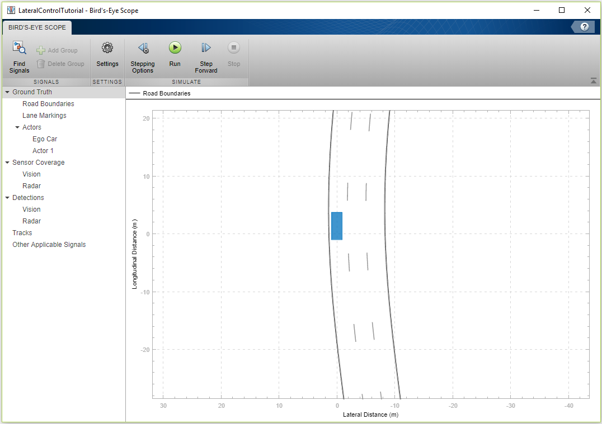

# Lateral Control for an Autonomous Vehicle (MATLAB / Simulink)

A PID lateral (steering) controller for a self-driving vehicle, designed with a classic
**black-box system identification → transfer function → PID tuning** workflow, built on
top of MathWorks' Automated Driving *Lateral Control Tutorial*.

This started as an `RIE 307 Control Systems` course project. Given a Simulink vehicle/environment
block that steers a car along a road, the goal was to identify its input–output behavior, fit a
transfer function to it, and design a PID controller — tuned two different ways (grid search and
root locus) — that tracks a target steering angle within a tight set of performance specs.

Full write-up, including plots and derivations: **[`docs/Report.pdf`](docs/Report.pdf)**.

## Results

| Spec               | Target (final) | Achieved       |
|---------------------|-----------------|----------------|
| Rise time            | —               | 1.75 ms        |
| Settling time         | —               | 69 ms          |
| Max overshoot         | < 20%           | < 3%           |
| Undershoot            | —               | 8.39%          |
| Steady-state error    | 10%             | ~0.1%          |

*(Initial loose specs were 0.5 s rise time / 2 s settling time / 20% overshoot / 10% steady-state
error — the final root-locus design comfortably beats all of them. See `docs/Report.pdf` §5–6 for
how the specs were tightened iteratively.)*



## How the controller was built

1. **Data generation** — Captured steering-angle input/output data by running the stock
   `LateralControlTutorial` vehicle/environment block (three input/output recordings).
2. **System identification** — Used the System Identification Toolbox (`tfest`) on one recording
   to fit a continuous transfer function, and validated it against the other two
   (`control_design/TFEXTRACT.m`):

   ```
   TF(s) = (-0.01984 s² + 18.65 s + 9.041e04) / (s² + 169.2 s + 8.982e04)
   ```

3. **PID design** — Closed the loop around a 90° step reference and tuned a PID controller two
   ways:
   - **Grid search** (`control_design/Grid_Search_control_model.slx`) — manually swept P, then I,
     then D gains until the response met spec.
   - **Root locus** (`control_design/Root_Locus_control_model.slx`, via Control System Designer —
     sessions saved as `ControlSystemDesignerSession1.mat` / `...2.mat`) — two iterations, moving
     from a complex zero to two real zeros to bring overshoot under 20%.
4. **Discretization** — Converted the tuned analog controller to the Z-domain (`c2d`, `Ts = 0.05 s`)
   and derived the difference equation for a digital implementation
   (`control_design/DigitalTF.mat`):

   ```
   y[n] = -0.01984·x[n] + 1.027·x[n-1] + 0.00694·x[n-2]
          - 0.006891·y[n-1] - 0.0002123·y[n-2]
   ```

## Requirements

- MATLAB (developed/tested on R2020a; the base tutorial models were generated with R2018b–R2020a
  and should open on any reasonably recent release)
- Simulink
- Automated Driving Toolbox (for the `LateralControlTutorial` scenario/vehicle model)
- Control System Toolbox
- System Identification Toolbox (only needed if you want to re-run `TFEXTRACT.m` yourself —
  not required just to run the pre-tuned controller)

## Quick start

```matlab
% From MATLAB, cd into the cloned repo, then:
startup                                    % adds every project folder to the path
open control_design/CIEControlSimulink.slx % main closed-loop PID model
```

Opening `CIEControlSimulink.slx` automatically runs `helperLateralControlTutorialSetup.m`
(via its `PostLoadFcn`), which builds the driving scenario, generates the reference path, and
creates the Simulink bus definitions the model needs. Once it finishes loading, press **Run**.

> Always run `startup.m` first (or otherwise add all project folders to your MATLAB path) —
> the models locate each other and their helper scripts by name via the path, not by relative
> folder location.

To explore the tuning process itself instead of just the final result, open
`control_design/Grid_Search_control_model.slx` or `control_design/Root_Locus_control_model.slx`,
or step through `control_design/TFEXTRACT.m` with the data in `control_design/data/`.

## Repository layout

```
control_design/            The actual course project: system ID + PID design & tuning
├── CIEControlSimulink.slx        Main closed-loop model (PID + plant)
├── TFEXTRACT.m                   Fits the transfer function from recorded I/O data
├── Grid_Search_control_model.slx PID tuned by manual grid search
├── Root_Locus_control_model.slx  PID tuned via Control System Designer / root locus
├── ControlSystemDesignerSession[1|2].mat   Saved root-locus tuning sessions (iter. 1 & 2)
├── ControlWorkspace.mat          Workspace variables the models depend on
├── DigitalTF.mat                 Discretized (Z-domain) transfer function
└── data/
    ├── NewInput[1-3].mat, NewOutput[1-3].mat   Data used to fit + validate the final TF
    ├── Input[2-3].mat, Output[2-3].mat         Validation-run recordings (Report §3)
    └── legacy/                   Superseded early data captures — kept for the record, not
                                   used by anything. (Originally named Input.mat/input.mat/
                                   Output.mat/output.mat/outpuT.mat — five files that collided
                                   into each other on case-insensitive filesystems, i.e. macOS/
                                   Windows, corrupting the checkout. Renamed here to fix that.)

lateral_control_tutorial/  The MathWorks base plant: vehicle + road environment the PID
├── LateralControlTutorial.slx    Base tutorial model (vehicle & environment block)
├── helperLateralControlTutorialSetup.m   Entry-point setup script (called automatically)
├── helper*.m                     Scenario / bus / path-following helper functions
├── HelperPathAnalyzer.m
├── lateralControlTutorial.mat, DrivingScenarioFile.mat   Generated/supporting scenario data
└── scenario_variants/            Earlier numbered iterations of the driving scenario used
                                   during development (kept for reference)

kinematic_vehicle_demo/    Unrelated standalone demo: a simple 2D kinematic vehicle
│                          animation (not part of the PID control project). See its own
│                          README for details — credit: Marc Compere.
└── ...

docs/
├── Report.pdf              Full project write-up (abstract, method, results, appendix)
├── images/                  Result screenshots (bird's-eye scope, crosstrack error, lane change)
└── kinematic_vehicle_demo/  Supporting docs for the standalone demo above

startup.m                  Run first: adds every folder above to the MATLAB path
```

## Notes / known limitations

- The Control System Designer session files (`ControlSystemDesignerSession1.mat`, `...2.mat`)
  may embed the original author's machine-specific path metadata internally (a limitation of
  that MATLAB app's session format, not something fixable by reorganizing files). If reopening a
  session doesn't relink automatically, just re-run `control_design/Root_Locus_control_model.slx`
  directly.

## License

[MIT](LICENSE) for the project's own work (`control_design/`, `docs/`, `startup.m`). The
third-party folders keep their original terms: `lateral_control_tutorial/` (MathWorks) and
`kinematic_vehicle_demo/` (Marc Compere). See [`LICENSE`](LICENSE) and [`NOTICE`](NOTICE).

## Credits

- Built on MathWorks' [Lateral Control Tutorial](https://www.mathworks.com/help/driving/ug/lateral-control-tutorial.html)
  (Automated Driving Toolbox) for the vehicle/environment plant.
- `kinematic_vehicle_demo/` is Marc Compere's 2D kinematic vehicle steering & animation template.
- Project: Ahmed Hamdy, Ahmed Sami, Abdelrahman Abbas — RIE 307 Control Systems.

---

**Ahmed H. Abdelrazik** · [aabdelrazik.github.io](https://aabdelrazik.github.io)
